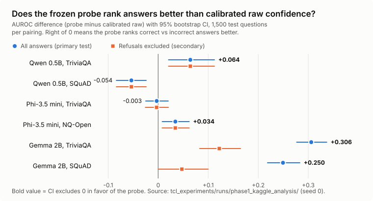

# Truth Calibration Layer (TCL)


Language models say wrong things with the same fluency as right things. **TCL is my research program to make a model emit, alongside each answer, a calibrated estimate of how much that answer can be trusted, and to have that ability learned inside the model rather than bolted on afterwards.**

The core claim I am testing is that training a small trust head *jointly* with the language model (`L_LM + lambda * L_trust`) produces better and more transferable trust estimates than a probe on a frozen model, without hurting generation. The research runs in phases, each with predeclared hypotheses, locked protocols, and pass/fail rules written before any results are seen.

## Where the Research Stands

| Phase | Question | Status |
|---|---|---|
| 0. Theory | A consistent, testable formulation of TCL | **Done**: [theory paper v2](paper/TCL-Theory-Paper-v2.md) |
| 1. Foundation | Do frozen hidden states carry correctness signal beyond calibrated confidence, and does it transfer? | **Closed**: signal is real but small and model-dependent; it does not transfer |
| 2. Core test (H3) | Does joint training beat a frozen head trained on the same data? | **Next** |
| 3. Trust vector (H4) | Are further trust dimensions (self-consistency, grounding, evidence density) learnable and non-redundant? | Planned |
| 4. Generalization (H5) | Do the results hold on math (GSM8K) and a 7-8B model? | Planned |
| 5. Claim level (H6) | Can trust be estimated per claim in long-form text? | Planned |

The full plan, hypotheses, decision gates, and change log are in [TCL-Research-Program.md](TCL-Research-Program.md).

## Phase 1 Results

Three open models (Qwen2.5-0.5B-Instruct, Phi-3.5-mini-instruct, Gemma 2B-it) on three QA datasets (TriviaQA, SQuAD, NQ-Open), 1,500 test questions per pairing. Six pairings met the size rule (at least 150 correct and 150 incorrect test answers).



| Pairing | Raw confidence | Semantic entropy (10 samples) | Frozen probe (1 pass) | Probe - calibrated raw [95% CI] |
|---|---:|---:|---:|---|
| Qwen, TriviaQA | 0.712 | 0.765 | 0.776 | **+0.064** [0.021, 0.112] |
| Qwen, SQuAD | 0.772 | 0.763 | 0.718 | -0.054 [-0.084, -0.024] |
| Phi, TriviaQA | 0.833 | 0.837 | 0.826 | -0.003 [-0.025, 0.020] |
| Phi, NQ-Open | 0.770 | 0.761 | 0.795 | **+0.034** [0.008, 0.062] |
| Gemma, TriviaQA | 0.527 | 0.560 | 0.841 | **+0.306** [0.277, 0.337] |
| Gemma, SQuAD | 0.620 | 0.503 | 0.870 | **+0.250** [0.219, 0.283] |

AUROC for ranking correct above incorrect answers; higher is better.

**What Phase 1 established:**

1. **Frozen hidden states carry a real but small correctness signal.** The probe beats calibrated raw confidence in 4 of 6 pairings, exactly the threshold for my H1-R rule. For Qwen and Phi the gains are +0.03 to +0.06, and the probe is significantly worse on Qwen SQuAD.
2. **Gemma's large gains are partly refusal detection.** Gemma declines to answer 17-30% of questions. Excluding refusals, its gains shrink to +0.12 and +0.05.
3. **Frozen probes do not transfer across datasets.** Trained on one dataset, Qwen's probes rank answers *worse than raw confidence* on another; Phi's add nothing. This is where a jointly trained trust head has to prove itself in Phase 2.
4. **A single-pass probe roughly matches semantic entropy**, which needs 10 extra generations per question, for Qwen and Phi.
5. **Middle layers carry more signal than the final layer**, so Phase 2's trust head reads from 50% depth.

Phase 1 also caught problems in the earlier TCL-v0 records: test sets too small to detect these effects, a SQuAD subset whose train and test questions shared passages, and an automatic labeling rule that is wrong on 6.7% of answers (mostly correct answers marked wrong). All of this is documented in [docs/phase1/](docs/phase1/).

## What I Claim and What I Do Not

**Supported by current evidence:**
- Frozen hidden states contain answer-correctness signal beyond calibrated token confidence, for some models and datasets, under the tested QA settings.
- That signal does not reliably transfer across datasets.
- A one-pass probe can approach the ranking quality of sampling-based semantic entropy at a fraction of the cost.

**Not claimed:**
- That TCL's joint-training claim is validated. That is Phase 2.
- That TCL makes models truthful, solves hallucination, or verifies open-ended factuality.
- That results generalize beyond the tested models (0.5B-3.8B) and short-answer QA.
- That trust scores are ready for deployment decisions.

## Repository Map

| Path | What it holds |
|---|---|
| [TCL-Research-Program.md](TCL-Research-Program.md) | Master plan: hypotheses, locked evaluation protocol, phases, gates, change log |
| [paper/](paper/) | [Theory paper v2](paper/TCL-Theory-Paper-v2.md) (current), theory paper v1, and the archived TCL-v0 empirical note |
| [docs/phase1/](docs/phase1/) | Phase 1 protocols (locked before evaluation), checkpoints with all results, and the label audit |
| [docs/archive/tcl-v0/](docs/archive/tcl-v0/) | June 2026 TCL-v0 notes, runbooks, and run logs, kept for history |
| [tcl_experiments/](tcl_experiments/) | Code, question sets with fixed splits, run records, and analysis outputs |
| [notebooks/](notebooks/) | Kaggle notebooks for GPU runs |
| [assets/](assets/) | Figures and the scripts that generate them |

Start with [docs/README.md](docs/README.md) for a guided reading order.

## Reproducing Phase 1

Requirements: Python 3.10+, the packages in `tcl_experiments/requirements.txt`, and a GPU (I used free Kaggle T4s) for inference. The analysis runs on a CPU.

```bash
pip install -r requirements.txt
```

**1. Question sets.** Already committed in `tcl_experiments/data/phase1_kaggle/` with fixed splits. To rebuild them:

```bash
python tcl_experiments/scripts/prepare_phase1_kaggle_data.py
```

**2. Inference (GPU).** Run [notebooks/tcl_phase1_kaggle_runs.ipynb](notebooks/tcl_phase1_kaggle_runs.ipynb) on Kaggle, one model per session. It pins the exact code commit and writes records plus hidden states.

**3. Analysis (CPU).** Unzip the Kaggle outputs into `tcl_experiments/runs/phase1_kaggle/<model>/<dataset>/`, then:

```bash
python tcl_experiments/scripts/run_phase1_kaggle_analysis.py
```

The committed records include everything except the hidden-state arrays (`*.npz`, excluded by `.gitignore` for size). The local TCL-v0 re-analysis is `tcl_experiments/scripts/run_phase1_analysis.py`.

**4. Figure.**

```bash
python assets/make_phase1_figure.py
```

## How I Work

- **Every experiment maps to a hypothesis** in the research program, with a metric, baselines, and a pass/fail rule fixed in advance.
- **Protocols and analysis code are committed before results exist.** Later changes are logged as amendments with the reason and the evidence that forced them.
- **Negative results are reported in full.** Phase 1's local H1 and H2 failures stay on record next to the corrected replication.
- **Primary metrics are ranking-based** (AUROC, AURC), with calibration (ECE, Brier) measured only after giving every method the same post-hoc calibration, so that a method cannot win just by being recalibrated.

## Author

Awab Mohamed, independent researcher, Qatar.

```bibtex
@misc{mohamed2026tcl,
  author = {Mohamed, Awab},
  title  = {Truth Calibration Layer: Jointly Trained, Multi-Dimensional Trust Estimation for Language Models},
  year   = {2026},
  url    = {https://github.com/awabmoha/truth-calibration-layer}
}
```
