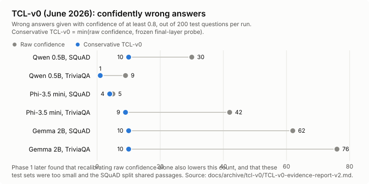
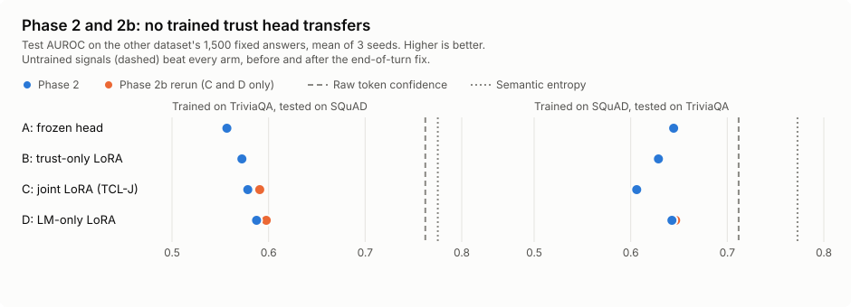
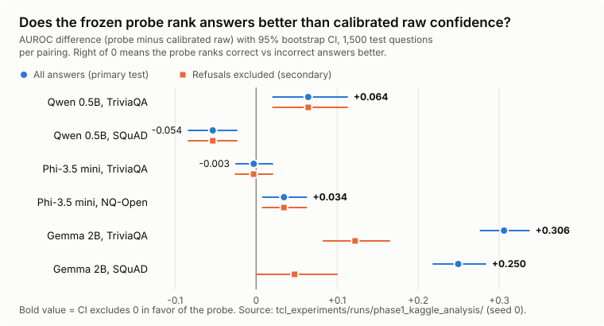
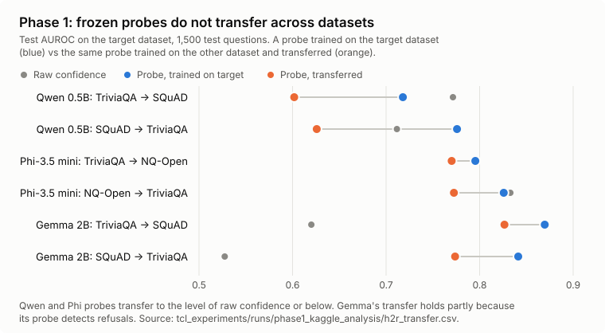
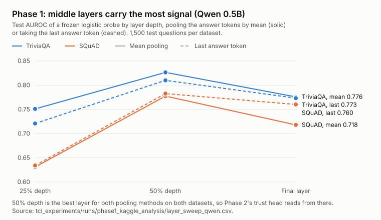

# Truth Calibration Layer (TCL)


Language models say wrong things with the same fluency as right things. **TCL is my research program to make a model emit, alongside each answer, a calibrated estimate of how much that answer can be trusted, and to have that ability learned inside the model rather than bolted on afterwards.**

I ran it in phases, each with predeclared hypotheses, locked protocols, and pass/fail rules written before any results were seen. **The program is closed (November 28, 2026), and its answer is negative:** on short-answer QA, from 0.5B to 7B parameters, learned hidden-state trust signals (frozen probes, jointly trained heads, mixture-trained heads, and two extra trust dimensions) add little or nothing beyond the model's own answer probability on data they were not trained on. Apart from Phase 1's in-distribution result, every preregistered test failed, every failure is reported here, and the whole program is being written up as one paper ([docs/final/](docs/final/)).

## Where the Research Stands

| Phase | Question | Status |
|---|---|---|
| 0. Theory | A consistent, testable formulation of TCL | **Done**: [theory paper v2](paper/TCL-Theory-Paper-v2.md) |
| 1. Foundation | Do frozen hidden states carry correctness signal beyond calibrated confidence, and does it transfer? | **Closed**: signal is real but small and model-dependent; it does not transfer |
| 2. Core test (H3) | Does joint training beat a frozen head trained on the same data? | **Done**: H3 fails, twice. Joint training does not transfer; the claim is dropped ([Phase 2](docs/phase2/TCL-Phase2-Checkpoint.md), [Phase 2b](docs/phase2/TCL-Phase2b-Checkpoint.md)) |
| 3. Transfer + trust vector (H4-T, H4) | Can a head trained on several datasets beat raw confidence on a new one? Are further trust dimensions learnable and non-redundant there? | **H4-T fails:** the head beats raw confidence on 1 of 6 held-out pairs; TCL's correctness dimension becomes calibrated raw confidence ([checkpoint](docs/phase3/TCL-Phase3-Checkpoint.md)). **H4 (self-consistency) fails by one pair:** learnable from one pass everywhere, adds to raw confidence on 3 of 6 ([checkpoint](docs/phase3/TCL-Phase3-H4-Consistency-Checkpoint.md)). **H4 (grounding) fails:** learnable, but adds to raw confidence on 2 of 7 pairs ([checkpoint](docs/phase3/TCL-Phase3-H4-Grounding-Checkpoint.md)). Trust is one-dimensional at this scale; Phase 4 re-tests |
| 4a. Phase 3 tests at 7B | Do the Phase 3 tests pass on Qwen2.5-7B? | **Fails:** no learned head beats raw confidence (0 of 3 pairs); self-consistency adds to it on 2 of 3 but misses on PopQA; grounding not testable. Trust is one-dimensional from 0.5B to 7B on QA ([checkpoint](docs/phase4/TCL-Phase4a-Checkpoint.md)) |
| 4b. Generalization (H5) | Math (GSM8K) and joint training at 7B | **Not run:** the program closed at this gate |
| 5. Claim level (H6) | Can trust be estimated per claim in long-form text? | **Not started** |

The full plan, hypotheses, decision gates, and change log are in [TCL-Research-Program.md](TCL-Research-Program.md).

**The program is closed (November 28, 2026).** Apart from Phase 1's in-distribution result, every preregistered test failed, in one consistent pattern: on short-answer QA from 0.5B to 7B, learned hidden-state trust signals add little or nothing beyond the model's own answer probability on new data, and what they add appears where that confidence is weak. I am writing the whole program up as one paper. The cross-phase synthesis, the literature review that fixes which findings are new, and the paper outline are in [docs/final/](docs/final/).

## How the Project Got Here

**June 2026: theory paper v1 and TCL-v0.** I started with the [theory paper v1](paper/TCL-Theory-Paper-v1.docx) and a first empirical test of one narrow part of it, TCL-v0: a logistic probe on a frozen model's final-layer hidden states, predicting whether the model's answer is correct. I ran it on Qwen2.5-0.5B, Phi-3.5-mini, and Gemma 2B on SQuAD and TriviaQA (six runs of 1,000 questions, 200 held out for testing, with manual review of the labels). The most consistent finding was that a conservative rule, `min(raw confidence, probe confidence)`, cut the number of confidently wrong answers, especially on TriviaQA and Gemma. I published it as releases v0.1.0 to v0.1.5, framed as preliminary evidence rather than validation of TCL.



**October 2026: a stricter program.** Looking back at TCL-v0, I decided that working checkpoint by checkpoint was not strong enough to prove the full idea. I wrote [TCL-Research-Program.md](TCL-Research-Program.md): one long-term plan with numbered hypotheses, locked protocols, and pass/fail rules fixed before any result. Phase 0 rewrote the theory into [paper v2](paper/TCL-Theory-Paper-v2.md), which separates the jointly trained version I am trying to prove (TCL-J) from the frozen-probe version TCL-v0 tested (TCL-F), and has every reference checked against its source.

**Phase 1 re-tested TCL-v0 at scale** (1,500 test questions per run instead of 200, a third dataset, a layer sweep, and stronger baselines such as semantic entropy). It confirmed a real hidden-state signal, but also showed what TCL-v0 could not see: its 200-question test sets were too small, its SQuAD questions shared passages between train and test, its headline metric could be matched by recalibrating raw confidence alone, and one checkpoint used automatic rather than reviewed labels. The Phase 1 results below replace the TCL-v0 numbers; the original records are kept unchanged in [docs/archive/tcl-v0/](docs/archive/tcl-v0/).

**Phase 2 tested the core claim** that TCL-v0 never could: whether training the trust head jointly with the model beats a frozen probe on a dataset it was not trained on. It does not (below). I then found a flaw in my setup (the model was never taught where to stop answering), fixed it, and ran the one rerun the plan allows (Phase 2b). The fix worked, but the transfer result did not change, so I dropped the joint-transfer claim.

**Phase 3 tested the strongest version of a learned correctness head I could design:** trained on a mixture of datasets, given raw confidence as an input, and tested on a held-out dataset, including PopQA, which no earlier phase used. It still does not beat the model's calibrated raw confidence (below), so raw confidence becomes TCL's correctness signal.

## Phase 3 Results

Qwen2.5-0.5B and Phi-3.5-mini; heads trained on two or three of TriviaQA, SQuAD, and NQ-Open and tested on a dataset left out of training, or on PopQA. The head design (an MLP) was chosen on validation splits only; 5 seeds; the analysis ran once.

| Test AUROC | Raw confidence (R) | Mixture head + raw conf. (M+R) | M+R - R [95% CI] | Semantic entropy |
|---|---:|---:|---|---:|
| Qwen, TriviaQA | 0.712 | 0.744 | +0.032 [-0.010, +0.077] | 0.773 |
| Qwen, SQuAD | **0.762** | 0.667 | -0.096 [-0.131, -0.061] | 0.775 |
| Qwen, PopQA | 0.828 | **0.907** | **+0.079** [+0.052, +0.105] | 0.879 |
| Phi, TriviaQA | **0.836** | 0.795 | -0.041 [-0.064, -0.017] | 0.842 |
| Phi, NQ-Open | 0.765 | 0.760 | -0.006 [-0.036, +0.024] | 0.762 |
| Phi, PopQA | **0.864** | 0.809 | -0.055 [-0.080, -0.029] | 0.881 |

**H4-T fails:** the head beats raw confidence on 1 of 6 pairs, and the preregistered rule needed 4. Training on a mixture does improve transfer over single-dataset heads on every pair, but not enough, and the head mostly ignores its raw-confidence input. The one clear win (Qwen on PopQA, where the model answers 9.5% correctly with confident guesses) is a lead for later work. Full results and label audits (1 rule error in 100 per model): [Phase 3 checkpoint](docs/phase3/TCL-Phase3-Checkpoint.md).

**H4, self-consistency.** I then tested whether a head can predict, from one pass, how consistently the model would answer if asked again (normally measured with 10 extra samples), and whether that adds to raw confidence. It is learnable on every held-out pair (AUROC 0.73-0.95) and not redundant with raw confidence, but it lowers selective-prediction AURC on only 3 of 6 pairs, where 4 were needed, so H4 fails by one pair. On Qwen, one pass plus raw confidence matches or beats semantic entropy (TriviaQA 0.785 vs 0.773, PopQA 0.895 vs 0.879 AUROC). Details: [H4 checkpoint](docs/phase3/TCL-Phase3-H4-Consistency-Checkpoint.md).

**H4, grounding.** Last, I tested whether a head can tell, from one pass, whether an answer is supported by the passage the model was given (MRQA reading comprehension, one third of passages swapped for unrelated ones, RelationExtraction held out). It is learnable on 6 of 7 held-out pairs and not redundant with raw confidence, but it lowers AURC on only 2 of 7, so H4 fails for grounding too. What the head mostly learns is to spot an irrelevant passage; among answers given from the right passage it adds nothing, and Phi, which already answers "unanswerable" to most irrelevant passages, gains almost nothing. The NLI grounding label was wrong on 23 of 100 audited answers. With both dimensions failed, trust is effectively one-dimensional at this scale, and Phase 4 re-tests at 7-8B. Details: [grounding checkpoint](docs/phase3/TCL-Phase3-H4-Grounding-Checkpoint.md).

## Phase 4a Results

I re-ran Phase 3's three tests unchanged on Qwen2.5-7B-Instruct (float16 on Kaggle's two T4s, about 11 GPU hours), with one fix chosen before any 7B data: a better grounding label. **All three fail.**

- **H4-T:** adding hidden states to calibrated raw confidence makes the ranking slightly worse on all 3 held-out pairs (TriviaQA, NQ-Open, PopQA).
- **H4, self-consistency:** passes on TriviaQA and NQ-Open, misses on PopQA by a CI bound of -0.0003; the rule requires the PopQA pair, so it fails. One pass plus raw confidence again matches or beats 10-sample semantic entropy (TriviaQA 0.869 vs 0.864, NQ-Open 0.772 vs 0.747 AUROC).
- **H4, grounding:** not testable. The 7B model says "unanswerable" to 1,996 of 2,000 irrelevant passages and is rarely wrong on what it answers, so the RelationExtraction pair fails the size rule; the two eligible pairs fail anyway.

Trust is effectively one-dimensional from 0.5B to 7B on QA, and I drop the multi-dimensional claim at this program's scale. One ungated check changes how I read Phase 3: with the fixed grounding label, the Phase 3 grounding test would have passed (5 of 7 pairs, mostly from irrelevant-passage answers); its recorded failure stands, but it was partly a labeling failure. Details, audits, scale comparison: [Phase 4a checkpoint](docs/phase4/TCL-Phase4a-Checkpoint.md).

## Phase 2 and 2b Results

Qwen2.5-0.5B with LoRA, trained on TriviaQA or on SQuAD (2,500 questions), tested on 1,500 fixed answers from each dataset; 3 seeds per arm, 28 trainings. Arm A is a frozen-backbone trust head, B fine-tunes the backbone for trust only, C is TCL-J (`L_LM + lambda * L_trust`), and D fine-tunes for language modeling only, then trains a head.

| Test AUROC | A | B | C (TCL-J) | D | Raw confidence |
|---|---:|---:|---:|---:|---:|
| TriviaQA, trained on TriviaQA | 0.830 | 0.828 | **0.849** | 0.840 | 0.712 |
| SQuAD, trained on SQuAD | 0.762 | 0.793 | **0.803** | 0.797 | 0.762 |
| SQuAD, trained on TriviaQA (transfer) | 0.557 | 0.572 | 0.578 | 0.588 | **0.762** |
| TriviaQA, trained on SQuAD (transfer) | 0.645 | 0.629 | 0.606 | 0.643 | **0.712** |

**What Phase 2 established:**

1. **H3-T and H3-J fail.** On a new dataset, joint training beats the frozen head in one direction (+0.022) and is significantly worse in the other (-0.038), and it fails my generation-quality bar.
2. **Joint training does help in-distribution**: it is the best arm on both datasets (+0.02 and +0.04 AUROC over the frozen head). But LM-only fine-tuning (D) gets most of that gain.
3. **No trained trust head transfers.** On the other dataset, every arm ranks answers far worse than the model's own token confidence or semantic entropy, which are trained on neither.
4. **I found a flaw in my setup:** the language-modeling target lacked the end-of-turn token, so fine-tuned models learned to answer in 9-20 words instead of 2.

**Phase 2b, the one preregistered rerun with that flaw fixed** (arms C and D retrained, 16 trainings):

| Transfer AUROC | A | B | C (TCL-J) | D |
|---|---:|---:|---:|---:|
| SQuAD, trained on TriviaQA | 0.557 | 0.572 | 0.591 | **0.598** |
| TriviaQA, trained on SQuAD | 0.645 | 0.629 | 0.606 | **0.647** |

5. **The fix worked:** fine-tuned models answer in 1-2 words again.
6. **The transfer result did not change.** From SQuAD to TriviaQA, joint training is still worse than the frozen head (-0.038), and from TriviaQA to SQuAD its gain (+0.034) is matched by LM-only fine-tuning (+0.041). H3-T fails again, so, as fixed in advance, **I drop the claim that joint training improves transfer.**



Full results and label audits: [Phase 2 checkpoint](docs/phase2/TCL-Phase2-Checkpoint.md) (4.3% of 300 fresh labels wrong) and [Phase 2b checkpoint](docs/phase2/TCL-Phase2b-Checkpoint.md) (5 of 100). The write-up, in ACL format, is [paper/acl-phase2/](paper/acl-phase2/) (DOI [10.5281/zenodo.24403374](https://doi.org/10.5281/zenodo.24403374)) ([readable version](paper/TCL-Phase2-Negative-Result.md)).

## Phase 1 Results

Three open models (Qwen2.5-0.5B-Instruct, Phi-3.5-mini-instruct, Gemma 2B-it) on three QA datasets (TriviaQA, SQuAD, NQ-Open), 1,500 test questions per pairing. Six pairings met the size rule (at least 150 correct and 150 incorrect test answers).



| Pairing | Raw confidence | Semantic entropy (10 samples) | Frozen probe (1 pass) | Probe - calibrated raw [95% CI] |
|---|---:|---:|---:|---|
| Qwen, TriviaQA | 0.712 | 0.765 | 0.776 | **+0.064** [0.021, 0.112] |
| Qwen, SQuAD | 0.772 | 0.763 | 0.718 | -0.054 [-0.084, -0.024] |
| Phi, TriviaQA | 0.833 | 0.837 | 0.826 | -0.003 [-0.025, 0.020] |
| Phi, NQ-Open | 0.770 | 0.761 | 0.795 | **+0.034** [0.008, 0.062] |
| Gemma, TriviaQA | 0.527 | 0.560 | 0.841 | **+0.306** [0.277, 0.337] |
| Gemma, SQuAD | 0.620 | 0.503 | 0.870 | **+0.250** [0.219, 0.283] |

AUROC for ranking correct above incorrect answers; higher is better.

**What Phase 1 established:**

1. **Frozen hidden states carry a real but small correctness signal.** The probe beats calibrated raw confidence in 4 of 6 pairings, exactly the threshold for my H1-R rule. For Qwen and Phi the gains are +0.03 to +0.06, and the probe is significantly worse on Qwen SQuAD.
2. **Gemma's large gains are partly refusal detection.** Gemma declines to answer 17-30% of questions. Excluding refusals, its gains shrink to +0.12 and +0.05.
3. **Frozen probes do not transfer across datasets.** Trained on one dataset, Qwen's probes rank answers *worse than raw confidence* on another; Phi's add nothing. This is where a jointly trained trust head has to prove itself in Phase 2.
4. **A single-pass probe roughly matches semantic entropy**, which needs 10 extra generations per question, for Qwen and Phi.
5. **Middle layers carry more signal than the final layer**, so Phase 2's trust head reads from 50% depth.





Phase 1 also caught problems in the earlier TCL-v0 records: test sets too small to detect these effects, a SQuAD subset whose train and test questions shared passages, and an automatic labeling rule that is wrong on 6.7% of answers (mostly correct answers marked wrong). All of this is documented in [docs/phase1/](docs/phase1/).

## What I Claim and What I Do Not

**Supported by the evidence (short-answer QA, 0.5B-7B):**
- Frozen hidden states carry answer-correctness signal beyond token confidence for some models and datasets, in distribution; it is large only where token confidence is poor (Gemma-2B).
- No learned correctness head beats the model's answer probability on a held-out dataset, including a head trained on a mixture of datasets and given that probability as an input (1 of 6 pairs at 0.5B and 3.8B, 0 of 3 at 7B).
- Joint LM + trust training improves the head in distribution but not on a new dataset, in two preregistered runs.
- A one-pass self-consistency head, combined with answer probability, matches or beats 10-sample semantic entropy on several held-out pairs, but its selective-prediction gain is small and passed the preregistered rule at no model size.
- A one-pass grounding head mostly detects answers given from an irrelevant passage, which a 7B model avoids by abstaining; NLI grounding labels are noisy enough to change the verdict.
- The choice of token-probability baseline matters: against first-token probability the learned head wins on 4 of 9 held-out pairs, against the answer-span or minimum-token probability on at most 1 (exploratory).

**Not claimed:**
- That joint training produces trust estimates that transfer across datasets. Phase 2 and its preregistered rerun (2b) tested this and it failed both times; the claim is dropped.
- That trust is multi-dimensional in a way learned heads can exploit: self-consistency and grounding both failed at 0.5B, 3.8B, and 7B.
- That these findings are new phenomena: the literature review ([docs/final/](docs/final/)) finds each of them partly reported before; what this program adds is a strict, preregistered, held-out-dataset test.
- That TCL makes models truthful, solves hallucination, or verifies open-ended factuality.
- That results generalize beyond the tested models (0.5B-7B) and short-answer QA.
- That trust scores are ready for deployment decisions.

## Repository Map

| Path | What it holds |
|---|---|
| [TCL-Research-Program.md](TCL-Research-Program.md) | Master plan: hypotheses, locked evaluation protocol, phases, gates, change log |
| [paper/](paper/) | The Phase 2 negative-result paper (ACL format), [theory paper v2](paper/TCL-Theory-Paper-v2.md), theory paper v1, and the archived TCL-v0 empirical note (the final paper will go here) |
| [docs/phase1/](docs/phase1/) | Phase 1 protocols (locked before evaluation), checkpoints with all results, and the label audit |
| [docs/phase2/](docs/phase2/) | Phase 2 labeling rule v3, the locked Phase 2 and 2b protocols, and both results checkpoints |
| [docs/phase3/](docs/phase3/) | The locked Phase 3 protocols and their checkpoints |
| [docs/phase4/](docs/phase4/) | The locked Phase 4a protocol and its checkpoint |
| [docs/final/](docs/final/) | The program synthesis, the final reporting analyses, the literature review (with its research notes), and the final paper outline |
| [docs/archive/tcl-v0/](docs/archive/tcl-v0/) | June 2026 TCL-v0 notes, runbooks, and run logs, kept for history |
| [tcl_experiments/](tcl_experiments/) | Code, question sets with fixed splits, run records, and analysis outputs |
| [notebooks/](notebooks/) | Kaggle notebooks for GPU runs |
| [assets/](assets/) | Figures and the scripts that generate them |

Start with [docs/README.md](docs/README.md) for a guided reading order.

## Reproducing Phase 1

Requirements: Python 3.10+, the packages in `tcl_experiments/requirements.txt`, and a GPU (I used free Kaggle T4s) for inference. The analysis runs on a CPU.

```bash
pip install -r requirements.txt
```

**1. Question sets.** Already committed in `tcl_experiments/data/phase1_kaggle/` with fixed splits. To rebuild them:

```bash
python tcl_experiments/scripts/prepare_phase1_kaggle_data.py
```

**2. Inference (GPU).** Run [notebooks/tcl_phase1_kaggle_runs.ipynb](notebooks/tcl_phase1_kaggle_runs.ipynb) on Kaggle, one model per session. It pins the exact code commit and writes records plus hidden states.

**3. Analysis (CPU).** Unzip the Kaggle outputs into `tcl_experiments/runs/phase1_kaggle/<model>/<dataset>/`, then:

```bash
python tcl_experiments/scripts/run_phase1_kaggle_analysis.py
```

The committed records include everything except the hidden-state arrays (`*.npz`, excluded by `.gitignore` for size). The local TCL-v0 re-analysis is `tcl_experiments/scripts/run_phase1_analysis.py`.

## Reproducing Phase 2 and 2b

**1. Training (GPU).** Run [notebooks/tcl_phase2_kaggle_runs.ipynb](notebooks/tcl_phase2_kaggle_runs.ipynb) on Kaggle (GPU T4 x2), once per training dataset and part. The notebook pins the code commit; `LM_TARGET = "reference"` reproduces Phase 2 and `LM_TARGET = "reference_eot"` with `ARMS = "C,D"` reproduces Phase 2b. Unzip each output into `tcl_experiments/runs/phase2/` (or `phase2b/`, with the Phase 2 A and B runs copied in).

**2. Analysis (CPU).**

```bash
python tcl_experiments/scripts/run_phase2_analysis.py
python tcl_experiments/scripts/run_phase2_analysis.py --in-dir tcl_experiments/runs/phase2b --out-dir tcl_experiments/runs/phase2b_analysis
```

Every run's scores, regenerated answers, and metrics are committed, so the analysis can be rerun without a GPU.

## Reproducing Phases 3 and 4a

Every Phase 3 and 4a analysis runs on a CPU from committed records, except that the hidden-state arrays (`*.npz`) are not committed; regenerate them with the pinned Kaggle notebooks ([notebooks/](notebooks/)). The step-by-step pipelines, with every script, are in [tcl_experiments/README.md](tcl_experiments/README.md). The final reporting analyses (minimum detectable effects, the corrected weak-confidence pattern, baseline choice) need only committed files:

```bash
python tcl_experiments/scripts/phase4a_ungated.py
python tcl_experiments/scripts/final_analyses.py
```

## Figures

```bash
python assets/make_phase1_figure.py
python assets/make_history_figures.py
python assets/make_phase2_figure.py
```

## How I Work

- **Every experiment maps to a hypothesis** in the research program, with a metric, baselines, and a pass/fail rule fixed in advance.
- **Protocols and analysis code are committed before results exist.** Later changes are logged as amendments with the reason and the evidence that forced them.
- **Negative results are reported in full.** Phase 1's local H1 and H2 failures stay on record next to the corrected replication, Phase 2's failed core claim is written up as a paper, and the whole program, which ended without a passing transfer test, is being written up as one paper.
- **Papers use the ACL format** (official ACL LaTeX style).
- **Primary metrics are ranking-based** (AUROC, AURC), with calibration (ECE, Brier) measured only after giving every method the same post-hoc calibration, so that a method cannot win just by being recalibrated.

## License

Code is under the MIT License; papers, docs, figures, and my run records are under CC BY 4.0, so you may reuse them with credit. Third-party datasets and models keep their own licenses. Details in [LICENSE](LICENSE).

## Author

Awab Mohamed, independent researcher, Qatar. To cite this work, use GitHub's "Cite this repository" button (from [CITATION.cff](CITATION.cff)) or the entries below.

```bibtex
@misc{mohamed2026tcl,
  author = {Mohamed, Awab},
  title  = {Truth Calibration Layer: A Research Program on Trust Estimation for Language Models},
  year   = {2026},
  url    = {https://github.com/awabmoha/truth-calibration-layer}
}

@misc{mohamed2026joint,
  author = {Mohamed, Awab},
  title  = {Joint Training Does Not Make Trust Heads Transfer: A Preregistered Negative Result},
  year   = {2026},
  publisher = {Zenodo},
  doi    = {10.5281/zenodo.24403374},
  url    = {https://doi.org/10.5281/zenodo.24403374}
}
```
